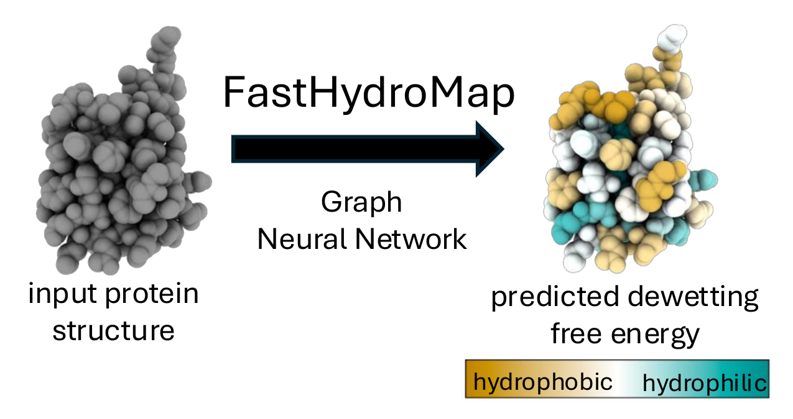

# FastHydroMap

FastHydroMap predicts residue-level hydrophobicity (`Fdewet`) and water-structure
maps (`PC1`, `PC2`, `PC3`) from protein structures. It runs on a
CPU without explicit-water simulations. Lower Fdewet indicates a more hydrophobic
local surface.

> This version is not yet available on PyPI or the ChimeraX Toolshed.
> The instructions below install it from this checkout.



## Quick start

From this repository's directory, in a fresh Python 3.12 environment:

```bash
python -m pip install -e .
fasthydromap install-torch
fasthydromap predict protein.pdb -o results/protein
```

This writes one CSV with all four scores, four PDBs with the scores in their
B-factor columns, and an NPZ file of [residue embeddings](docs/MODEL.md#residue-embeddings)
for downstream analysis.

For missing heavy atoms, add `--prepare` and inspect the saved prepared structure.

## ChimeraX

In ChimeraX, open **Tools → More Tools…**, find **FastHydroMap** in the
[Toolshed](https://cxtoolshed.rbvi.ucsf.edu/), and click **Install**.
Run `fasthydromap install` once to set up its Python dependencies, then predict
and color a structure:

```text
fasthydromap #1
fasthydromap #1 quantity pc1
```

See the [ChimeraX tutorial](docs/ChimeraX_tutorial.md) for installation,
coloring output PDBs, and interpreting the maps.

## Trajectories

```bash
fasthydromap predict-trajectory protein.pdb trajectory.dcd -o results/trajectory
```

DCD and XTC trajectory files are supported. This writes `trajectory.npz` with all four scores
per frame and residue, plus residue IDs and frame/time information.
Add `--csv` for a wide `_total.csv`, or `--embeddings` to include per-frame
embeddings in the NPZ.
Make sure you have a complete topology with matching atom order, and make molecules whole
before prediction.
See [how to load the results](docs/MODEL.md#loading-trajectory-results).

## Inputs and scope

Use standard protein heavy atoms. Ordinary HIS defaults to neutral HIE;
HID/HIE/HIP names or `--histidine-states states.csv` specify an assignment.
FastHydroMap does not estimate pKa. See [input details](docs/MODEL.md).

Training used restrained, single-chain protein simulations. Buried residues,
termini, assemblies, and unsupported chemistry need caution.

## Documentation and citation

- [Installation](docs/INSTALL.md)
- [Python API, inputs, embeddings, and model](docs/MODEL.md)
- [Training and data](training/README.md)

Lobo, S.; Najafi, S.; Shea, J.-E.; Shell, M. S. *Context-Aware Hydrophobicity
Modeling: HydroMap and FastHydroMap*. bioRxiv (2026).
[doi:10.64898/2026.06.07.730647](https://doi.org/10.64898/2026.06.07.730647).

[Shell Lab](https://theshelllab.org/) · [Shea Group](https://labs.chem.ucsb.edu/shea/joan-emma/)
