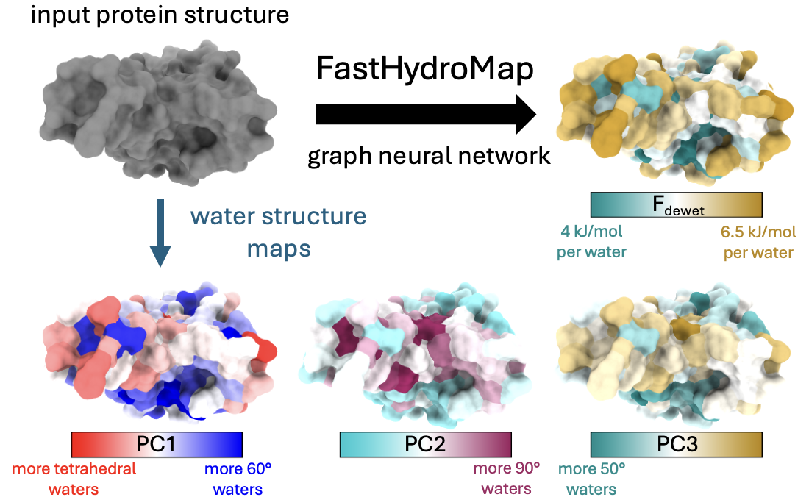
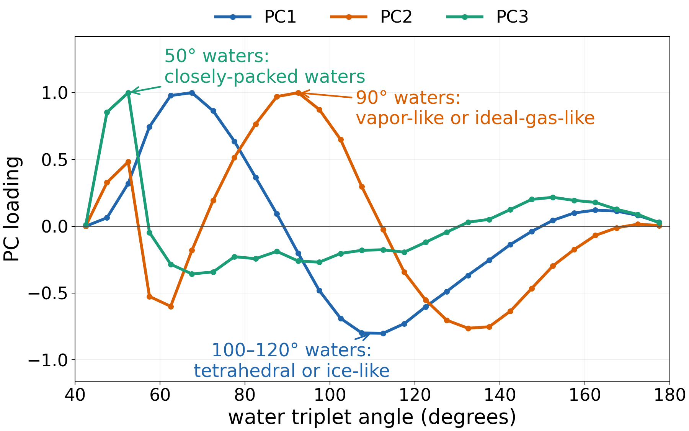

# FastHydroMap in ChimeraX

Predict residue-level Fdewet, PC1, PC2 and PC3 from a protein structure, then
color its atoms, cartoon or surface.



## Install once

In ChimeraX 1.12 or newer:

```text
toolshed install ChimeraX-FastHydroMap
fasthydromap install
```

Wait for successful installation in the Log. The bundle installs FastHydroMap
and CPU PyTorch into an isolated environment; a GPU is not needed. Updating the
bundle does not automatically update that environment.
Run `fasthydromap install` again to update it. The installer verifies a new
environment before switching to it and retains the previous installation if
the update fails.

## Make a map

```text
open 1ubq
fasthydromap #1
fasthydromap #1 quantity pc1
```

The first calculation computes all four quantities together and stores them as residue
attributes: `fasthydromap_fdewet`, `fasthydromap_pc1`,
`fasthydromap_pc2` and `fasthydromap_pc3`. The `quantity` option selects
which one to color; switching maps reuses the cached predictions when the input
and prediction settings are unchanged. Embeddings are also retained for later
export. Use `fasthydromap #1 refresh true` to force a new calculation.

With exactly one atomic model open, `fasthydromap` needs no model specifier.
With several open, it asks you to select one, for example `fasthydromap #1`.
Each selected model uses only its own internal coordinates and active frame:
moving it in the scene does not alter predictions, and other open models do
not contribute. Multiple explicitly selected models are analyzed independently.
An assembly must be in one atomic model to include its interchain contacts.
Commands operate on whole atomic structures, including hidden atoms, preserving
the surrounding protein context; selecting a chain is not a request to
remove the rest of its assembly.

The input needs complete standard heavy atoms. If missing atoms prevent
prediction (including a missing terminal oxygen, OXT), `prepare true` rebuilds
them in a temporary copy, without changing the open structure. It does not
reconstruct missing loops or make unsupported chemistry reliable.
Inspect rebuilt regions with the standalone CLI's
`--prepare` output when they matter to your interpretation.

```text
fasthydromap #1 prepare true
fasthydromap #1 prepare true quantity pc2 target cs
fasthydromap #1 prepare true quantity pc3 palette blue:white:red range -3,3
fasthydromap #1 prepare true color false
```

Prediction options are not sticky: repeat `prepare true` or `histidineStates`
when recoloring to retain those settings. Changed input coordinates, residue
identities, histidine-file contents, prediction options or installed model files
invalidate the cache. Color, palette and display range do not. The Log reports
cache reuse. Only the most recent input is cached per model, and caches are not
restored from saved sessions; old residue attributes alone never authorize reuse.
Unknown custom executable/editable-install layouts safely recalculate instead.

## Open a map from the command line

The standalone CLI writes one B-factor PDB per quantity. Open and color one
without installing the FastHydroMap bundle:

```text
open results/protein_fdewet.pdb
color bfactor range 4,6.5 palette ^lipophilicity
```

For PC maps, open the corresponding `_pc1.pdb`, `_pc2.pdb` or `_pc3.pdb` and
use the color ranges below.

## Interpret the values

Lower Fdewet means water is easier to remove: a more hydrophobic local surface.
Higher Fdewet indicates stronger water retention.

PC1–PC3 are signed projections of hydration-water angular distributions, not
three additional hydrophobicity scales. Interpret their signs using the
HydroMap loadings and their fixed convention:



| Map | Negative | Positive |
| --- | --- | --- |
| PC1 | More tetrahedral ordering (~100–120°) | More ~60° ordering |
| PC2 | More ~130–150° ordering relative to ~90° | More ~90° ordering |
| PC3 | Less ~40–50° ordering | More highly coordinated ~40–50° ordering |

PC color limits retain the original ranges: PC1 −8 to 8, PC2 −2 to 8, and
PC3 −2 to 2. These are display choices, not fitted percentiles. Values beyond
the limits receive the endpoint colors; **the residue attributes remain raw,
unclipped predictions**. Use `range low,high` to change the display.

## Histidines and embeddings

Ordinary HIS defaults to neutral HIE, with a warning. Named HIP/HIE/HID residues
are recognized. Explicit states can be supplied as a CSV with
`res_uid,histidine_state` columns (for example, `A:42,HIP`):

```text
fasthydromap #1 histidineStates /path/to/states.csv
fasthydromap #1 histidineStates /path/to/states.csv quantity pc1
fasthydromap #1 histidineStates /path/to/states.csv embeddings /path/to/protein_embeddings.npz
```

HIP changes both the charge flag and atom-level partial charges. HIE/HIP were
represented in training; HID is accepted but not validated by this dataset.
Assignments are not inferred from pH. Embedding export requires one structure
and a new output file; the NPZ includes residue IDs and checkpoint identity.

## Scope

These are structural predictions, not new HydroMap simulations. Buried residues,
termini, reconstructed regions and unfamiliar chemistry need caution.
Nonprotein context (ligands, membranes, nucleic acids and explicit waters) is
not modeled. Assembly predictions are useful structural extrapolations, not a
separately validated assembly-label benchmark. See [model notes](MODEL.md).

For the previous published model, use `model v0`; its PC display ranges remain
unchanged. Switching model/input clears incompatible attributes rather than
mixing results. Legacy targets are computed separately and cached as requested.
The default `model latest` is the model bundled with the installed
package, not a network download. Full command reference: `help fasthydromap`.
