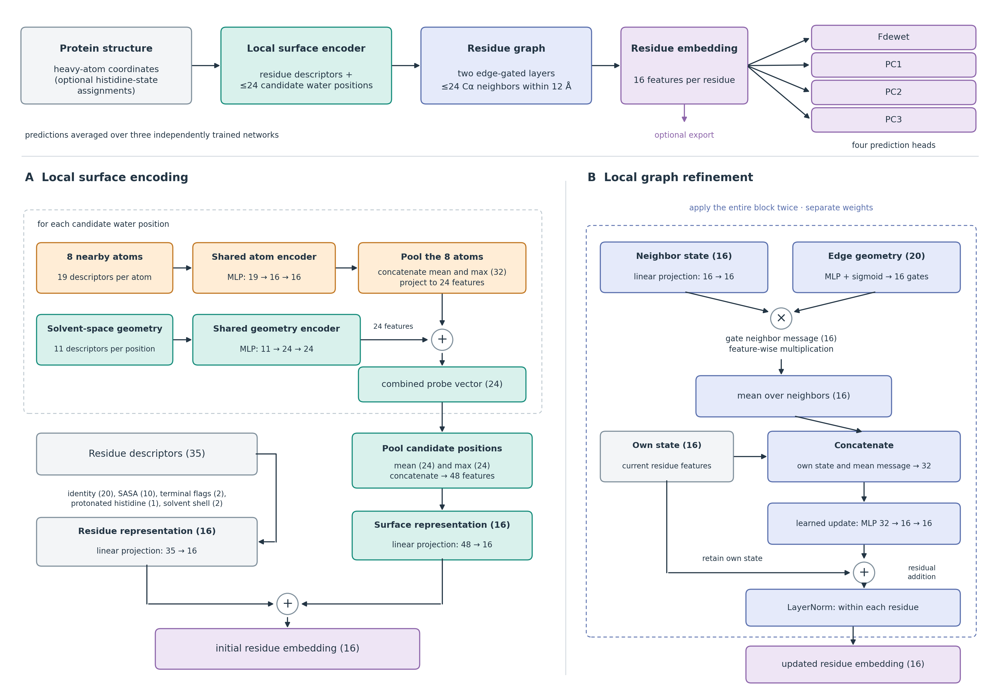

# Using the model

FastHydroMap maps protein structures to Fdewet, PC1, PC2, and PC3 at each residue. Fdewet is the dewetting free energy as predicted by [HydroMap](https://github.com/samlobe/HydroMap). PCs describe the principal components of the water 3-body angle distribution; see [here](https://doi.org/10.1021/acs.jpcb.3c00826).
All outputs share feature extraction and a small learned residue representation.

## Python usage

```python
from FastHydroMap import Predictor

model = Predictor(threads=4)
table = model.predict("protein.pdb")
table.to_csv("maps.csv", index=False)
fdewet = table["Fdewet"]
pc1 = table["PC1"]
```

Reuse `model` for additional structures. Each call returns a pandas DataFrame
with all four predictions, residue identifiers, and structural caution flags.
`threads` controls CPU workers (default: 4). Calls temporarily change PyTorch's
process-wide thread count; avoid concurrent calls that independently change it.

## Residue embeddings

```python
table = model.predict("protein.pdb", embeddings=True)
embedding = table[[f"embedding_{j}" for j in range(16)]].to_numpy()
```

Each embedding is a 16-dimensional residue representation after message passing,
available for downstream analysis. Predictions average three networks; embeddings
come from one designated network. Compare embeddings from the same trained model;
their coordinates can change after retraining and should not be averaged across networks.

The CLI saves these automatically in `<root>_embeddings.npz`, with arrays
`embedding` (residue × 16) and `res_uid`, plus model information.
Load it with `numpy.load(path, allow_pickle=False)`. Per-frame trajectory
embeddings are optional; see [loading trajectory results](#loading-trajectory-results).

## Inputs and histidines

Provide one PDB model with complete standard protein heavy atoms. Stable IDs
include chain, number and insertion code (`B:17A`); `_` is a blank chain.
Duplicate IDs and ambiguous alternate locations are rejected. Resolve alternate
locations or use `--prepare` before prediction.

Ordinary HIS defaults to HIE with a warning. Explicit HID/HIE/HIP residue names
are recognized. A CSV overrides assignments:

```csv
res_uid,histidine_state
A:42,HIP
B:17A,HIE
```

```bash
fasthydromap predict protein.pdb --histidine-states states.csv -o maps
```

In Python, pass `histidine_states={"A:42": "HIP"}` to `model.predict()`.
HIE/HID are neutral tautomers; HIP is positively charged. The assignment changes
both residue and nearby-atom features. Training includes HIE and HIP, but not
HID; HID inputs receive a caution. FastHydroMap does not estimate pKa or relax
the structure.

`--prepare` adds missing heavy atoms, removes heterogens, and saves a prepared
PDB for inspection. It preserves explicit histidine assignments but does not
rebuild missing sequence or convert nonstandard chemistry. It is available only
for individual structures: trajectory topology and atom ordering must remain fixed.
Hydrogen coordinates are ignored during feature calculation. For trajectories,
the topology must still match every atom in the trajectory, including hydrogens.
Ligand, water, and membrane context is not modeled.
Polymer caps and other nonstandard ATOM residues are rejected rather than
silently omitted.

Free C termini require both O and OXT. Equivalent OT1/OT2, O1/O2, and OC1/OC2
names are accepted. If OXT is missing, use `--prepare` for a single structure
and inspect the rebuilt atom. Trajectories must already contain it; preparation
cannot change their topology. Terminal chemistry contributes to the surrounding
environment, but terminal residues were excluded from fitting targets and retain
the `terminal_caution` flag. Capped peptides and isolated single-residue chains
are unsupported.

## Structure outputs

For `fasthydromap predict protein.pdb -o maps`:

| File | Contents |
| --- | --- |
| `maps.csv` | All four scores, residue IDs, histidine state, SASA (Ų), probe count, and caution flags |
| `maps_fdewet.pdb`, `maps_pc1.pdb`, `maps_pc2.pdb`, `maps_pc3.pdb` | One map per file, stored in the B-factor column |
| `maps_embeddings.npz` | Residue embeddings and their checkpoint identity |
| `maps.json` | Input/model hashes, histidine assignments, and run settings |

Use `res_uid` to match rows to structures; it retains chain and insertion-code
identity. The shorter `residue` column is a display label. Existing outputs
require `--overwrite` to replace.

## Loading trajectory results

```bash
fasthydromap predict-trajectory topology.pdb frames.dcd -o trajectory
```

This writes `trajectory.npz`, a compressed NumPy file containing all four
predictions for every residue at every frame—not simulation coordinates or waters.
The accompanying `trajectory.json` records the model and run settings.
DCD and XTC inputs are supported. Use matching topology and atom order, and make
molecules whole before prediction; periodic wrapping is not repaired.

```python
import numpy as np

with np.load("trajectory.npz", allow_pickle=False) as data:
    targets = data["targets"].tolist()  # Fdewet, PC1, PC2, PC3
    scores = data["scores"]            # float32 [frame, residue, target]
    pc1 = scores[:, :, targets.index("PC1")]
    residue_ids = data["res_uid"]      # chain-aware IDs, e.g. A:42
    frames = data["frame"]             # zero-based int64 indices
    times = data["time_ps"]            # float64; as reported by MDTraj
```

Times are reported by MDTraj and may be inferred from format defaults rather
than the original simulation clock.

Optional exports:

- `--embeddings`: adds `embedding[frame, residue, feature]` (16 features) to the NPZ.
- `--csv`: adds `<root>_total.csv`, with one row per frame and target-prefixed
  columns such as `PC1:42` or `PC1:A:42`. JSON maps these labels to `res_uid`.

Frames are processed individually, with temporary results stored on disk beside
the output. Allow space for both uncompressed results and the final archive.
For 10,000 frames and 100 residues, scores occupy 16 MB before compression;
embeddings add 64 MB. Loading an NPZ array brings the entire array into memory.

## Interpreting the maps

Lower Fdewet indicates easier water removal and a more hydrophobic local surface.
PC1–PC3 describe different aspects of hydration-water angular structure; see
the [interpretation guide](ChimeraX_tutorial.md#interpret-the-values) for their signs
and loadings. Suggested color ranges are:

| Quantity | Lower | Upper |
| --- | ---: | ---: |
| Fdewet | 4 | 6.5 |
| PC1 | -8 | 8 |
| PC2 | -2 | 8 |
| PC3 | -2 | 2 |

These ranges control visualization, not confidence; numerical outputs are not clipped.

## Architecture



[PDF](../images/architecture.pdf) · [Editable SVG](../images/architecture.svg)

The model combines sampled water positions with a local residue graph:

1. **Residue inputs:** amino-acid identity (20), SASA (10), termini (2), HIP
   state (1), and accessible-shell volume/emptiness (2) form 35 inputs, projected
   to a 16-dimensional residue state.
2. **Water probes:** up to 24 candidate water positions describe local openness
   and their eight nearest heavy atoms. Shared encoders and mean/max pooling
   incorporate this information into the residue state.
3. **Neighborhood refinement:** two edge-gated message-passing layers connect
   up to 24 Cα neighbors within 12 Å.
4. **Prediction:** four small heads read the refined residue state. Predictions
   are averaged over three networks, each with 8,740 parameters.

Chemistry includes partial charges with bonded hydrogen charges combined into
the heavy site; partial charges come from the
[a99SB-disp force field](https://doi.org/10.1073/pnas.1800690115).
See [third-party notices](../THIRD_PARTY_NOTICES.md) for parameter-data attribution.

## Scientific scope

Labels come from three independently seeded, restrained explicit-water replicas
for each of 1,000 protein chains. The bundled models were fitted on 800 chains;
see [training and reproducibility](../training/README.md) for data splits,
evaluation history, and the fitting protocol.

Training uses nonterminal residues with mean MD water count >7; Fdewet also uses
the [3.8, 8.7] label domain (based on HydroMap training data). PCs do not inherit that Fdewet filter.
`terminal_caution`, `zero_sasa_caution`, `no_probe_caution`, `assembly_caution`,
and `hid_unvalidated_caution` are structural warnings, not calibrated confidence
estimates. Their absence does not establish that a residue meets the MD-based
training criteria.

Supply the intended assembly; biological assemblies are not constructed.
Nearby chains contribute context, but multi-chain assemblies were not included in the training data.

Probe sampling is sensitive to small coordinate changes;
see the [coordinate-sensitivity check](../training/README.md#evaluation-and-coordinate-sensitivity).
